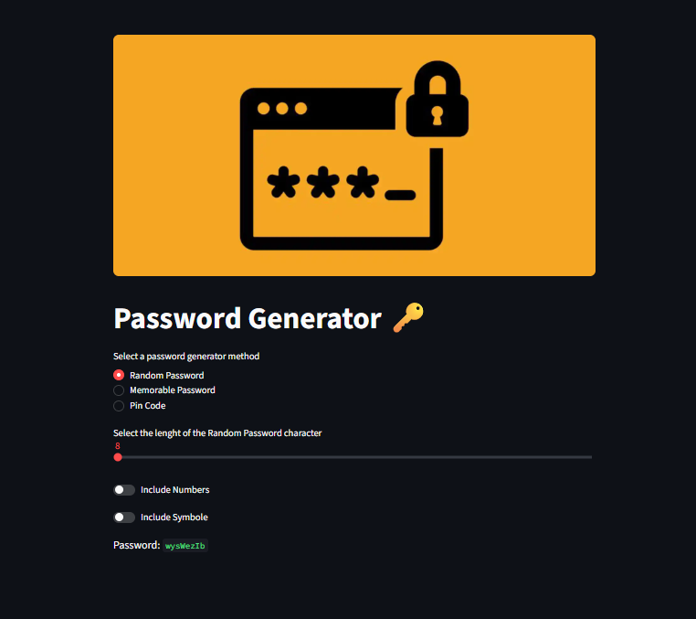

# Password Generator

A Python-based password generator featuring customizable random passwords, memorable word-based passphrases, and numeric PIN codes. Built using Object-Oriented Programming (OOP) principles, with an interactive web interface powered by Streamlit.

## Overview

Password Generator is a modular Python application that provides three different methods of generating passwords. Users can customize their passwords according to their needs, either through Python code or an interactive web dashboard.

## Features

- **Random Password Generator:** Generate customizable passwords with letters, numbers, and special characters.
- **Memorable Password Generator:** Create word-based passphrases using the NLTK English word corpus, with customizable separators and capitalization.
- **PIN Code Generator:** Generate numeric PIN codes with adjustable lengths.
- **Interactive Web Dashboard:** Use a Streamlit interface to configure and generate passwords.

## Technologies

- Python 3
- Object-Oriented Programming (OOP)
- NLTK
- Streamlit

## Project Structure

```text
.
├── README.md
├── requirements.txt
├── .gitignore
└── src/
    ├── main.py
    └── dashboard.py
```

## Preview

<!-- Add a screenshot of the Streamlit dashboard here -->



## Installation

1. Clone the repository:

```bash
git clone https://github.com/your-username/password-generator.git
cd password-generator
```

2. Create a virtual environment:

```bash
python -m venv venv
```

3. Activate the environment:

**Windows:**
```bash
venv\Scripts\activate
```

**Linux / macOS:**
```bash
source venv/bin/activate
```

4. Install dependencies:

```bash
pip install -r requirements.txt
```

## Usage

The application supports two ways of running the generators.

**1. Command-Line Interface**

Run the main Python script:

```bash
python src/main.py
```

**2. Streamlit Web Dashboard**

Launch the interactive dashboard:

```bash
streamlit run src/dashboard.py
```

The dashboard will open in your browser, usually at:

`http://localhost:8501`


### Configure Python Path (Linux / macOS)

Before running the application, configure the Python module search path from the project root:

```bash
export PYTHONPATH="${PYTHONPATH}:$(pwd)"
```

This allows Python to locate the `src` package and resolve internal imports.

---

## License

[Choose a license for this project]